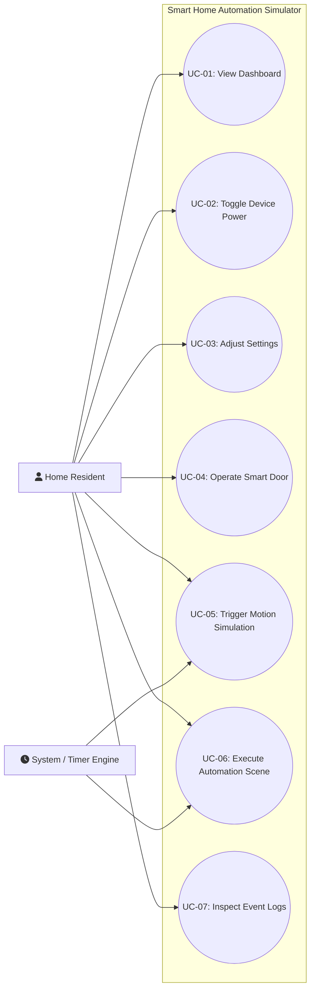
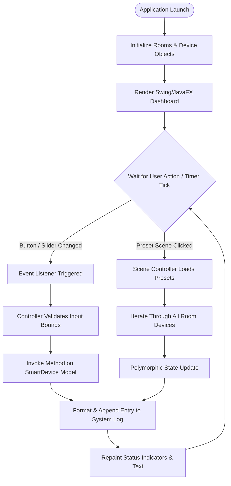

# Smart Home Automation Simulator
## Phase 1: Requirement Analysis and System Design Document
**Academic Context:** BCA / B.Tech (CSE/IT) / MCA Academic Project  
**Domain:** Desktop Application / Object-Oriented Software Engineering  
**Technology Stack:** Core Java, Object-Oriented Programming (OOP), Java Swing / JavaFX  

---

## 1. Project Title
**Smart Home Automation Simulator**  
*(A Pure Software-Based Object-Oriented Virtual Home Management Environment)*

---

## 2. Project Introduction
The **Smart Home Automation Simulator** is a standalone, desktop-based software application engineered to model, simulate, and visualize the automated control of modern household appliances and security systems. 

With the rapid adoption of home automation and Internet of Things (IoT) ecosystems, smart living has become a key area of study in software engineering. However, developing and testing automation logic directly on physical hardware can be expensive, complex to configure, and prone to hardware failure. 

This project bridges that gap by providing a **software-only simulation testbed**. Developed strictly in **Java** leveraging robust **Object-Oriented Programming (OOP)** principles and an interactive **Java Swing or JavaFX Graphical User Interface (GUI)**, the simulator allows users to monitor and interact with simulated appliances (lighting, ventilation fans, air conditioning, smart door locks, and security cameras) across various rooms in a home. The application demonstrates how real-world devices can be modeled as software objects, maintaining distinct states, responding to user input, and executing scheduled automation scenes.

---

## 3. Problem Statement
Setting up a physical smart home test environment for academic learning or software validation presents several practical challenges:
1. **High Hardware Cost:** Real IoT hardware—including microcontrollers (Arduino, ESP32, Raspberry Pi), relays, dimmers, motorized actuators, sensors, and wireless communication modules (Zigbee, Z-Wave)—is costly and often inaccessible for standard lab demonstrations.
2. **Hardware Fragility and Risk:** Wiring mistakes or electrical surges during physical testing pose safety risks and can permanently damage hardware components.
3. **Complex Low-Level Dependencies:** Developing firmware and network communication layers often distracts software students from mastering core software architecture, design patterns, state management, and user experience (UX) engineering.
4. **Lack of a Controlled Simulation Platform:** There is a scarcity of lightweight, educational software applications that clearly illustrate how to model smart appliances using foundational Object-Oriented paradigms (encapsulation, abstraction, inheritance, and polymorphism) inside an interactive desktop application.

---

## 4. Project Objectives
The primary objectives of the Smart Home Automation Simulator are:
- **To Model Household Appliances as Software Objects:** Create a robust object-oriented hierarchy representing common smart devices (Lights, Fans, ACs, Doors, Cameras).
- **To Deliver an Intuitive Visual Dashboard:** Design an interactive Java Swing / JavaFX GUI allowing users to monitor and toggle device states in real-time.
- **To Implement Granular Device Control:** Support multi-level state adjustments such as fan speeds (1–5), light dimmer levels (0–100%), and AC thermostat temperatures (16°C–30°C).
- **To Simulate Automated Home Scenes:** Provide preset macro routines (e.g., "Good Morning", "Night Mode", "Away Mode", "Party Mode") that orchestrate multiple device states with a single click.
- **To Maintain a Live Activity & Event Log:** Record and display all device state transitions with timestamps to simulate telemetry and audit trails.
- **To Emphasize Pure Software Simulation:** Eliminate dependencies on physical hardware or cloud subscriptions, ensuring the application runs out-of-the-box on any standard computer equipped with a Java Virtual Machine (JVM).

---

## 5. Scope of the Project

### 5.1 In-Scope
- **Device State Simulation:** Virtual representation of power states (ON/OFF), speed levels, temperature setpoints, door lock statuses, and camera surveillance feeds.
- **Room Organization:** Grouping simulated appliances into realistic rooms (Living Room, Master Bedroom, Kitchen, Entryway).
- **Interactive Controls:** Graphical toggles, sliders, radio buttons, and action buttons.
- **Visual Status Feedback:** Color-coded status indicators (e.g., Green for Active/ON, Slate/Gray for OFF, Red for Locked/Alert) and dynamic text feedback.
- **Scene Automation Engine:** Rule-based batch execution of device states for common lifestyle routines.
- **Event Logging Console:** In-memory, timestamped event log displaying user interactions and system transitions.

### 5.2 Out-of-Scope (Deferred to Future Work)
- Real IoT hardware integration (No Arduino, Raspberry Pi, microcontrollers, or physical sensors).
- Physical wiring, relays, or electrical circuits.
- Cloud backends, remote databases, or cloud synchronization.
- Real video streaming from physical IP cameras (camera feeds are simulated using animations, image snapshots, or visual status panels).
- Network-based multi-client or multi-tenant synchronization.

---

## 6. Proposed Solution
The proposed solution is an **event-driven, Model-View-Controller (MVC) desktop application** built in Java. 

```
+-----------------------------------------------------------+
|                        VIEW (GUI)                         |
|   Java Swing / JavaFX Dashboard, Room Cards, Controls    |
+-----------------------------+-----------------------------+
                              | User Clicks / Sliders
                              v
+-----------------------------------------------------------+
|                     CONTROLLER LAYER                      |
|       SimulationEngine / AutomationManager / Logger       |
+-----------------------------+-----------------------------+
                              | Dispatches State Changes
                              v
+-----------------------------------------------------------+
|                        MODEL LAYER                        |
|   SmartDevice Hierarchy (Light, Fan, AC, Door, Camera)   |
|                 Room & Scene Aggregates                   |
+-----------------------------------------------------------+
```

1. **Model Layer:** Houses the core domain logic. Devices inherit from an abstract base class `SmartDevice` and implement specialized behavioral interfaces. Rooms aggregate devices, and scenes define target configurations.
2. **View Layer:** Provides a clean graphical layout featuring a room selector, individual appliance control cards, a quick-scenes panel, an ambient environmental overview, and a live logging console.
3. **Controller / Simulation Engine:** Listens to user interactions from the GUI, validates requested changes, updates the model objects, notifies the view to redraw the state indicators, and appends formatted records to the activity log.

---

## 7. Functional Requirements

| Requirement ID | Module | Description |
| :--- | :--- | :--- |
| **FR-01** | Device Power Toggle | The system shall allow users to toggle any device between ON and OFF states. |
| **FR-02** | Lighting Brightness | The system shall allow users to adjust the brightness level of dimmable lights from 0% to 100% using a graphical slider. |
| **FR-03** | Fan Speed Regulation | The system shall allow users to set fan speed incrementally between levels 0 (Off) and 5 (Maximum). |
| **FR-04** | AC Temperature Control | The system shall allow users to adjust the target AC temperature between 16°C and 30°C and select operating modes (Cool, Fan, Eco). |
| **FR-05** | Smart Door Lock | The system shall permit users to lock and unlock the main door using a simulated PIN/passcode verification mechanism. |
| **FR-06** | Security Camera Simulation | The system shall simulate a camera feed showing active status, recording indicators, and a toggle to trigger virtual "Motion Detected" alerts. |
| **FR-07** | Preset Scene Activation | The system shall execute predefined multi-device configurations upon user selection (e.g., "Night Mode" turns off all lights, sets AC to 24°C, and locks all doors). |
| **FR-08** | Room-Wise Categorization | The system shall organize devices by room (Living Room, Bedroom, Kitchen, etc.) to allow focused monitoring and room-level master switches. |
| **FR-09** | Live Activity Logging | The system shall generate a real-time, timestamped log entry whenever a device state or automation scene is triggered. |
| **FR-10** | System Reset | The system shall provide a "Reset to Default" feature that brings all simulated devices back to a standardized initial state. |

---

## 8. Non-Functional Requirements

| Quality Attribute | Specification |
| :--- | :--- |
| **Usability** | The interface shall be self-explanatory, requiring no technical training. Interactive controls (buttons, sliders) must have clear labels and visual feedback (color changes). |
| **Performance** | The application must update device states and refresh UI indicators within **100 milliseconds** of a user click. |
| **Modularity** | The codebase must strictly adhere to OOP principles (SOLID). Adding a new device type (e.g., `SmartCurtain`) must require no modifications to existing device classes. |
| **Reliability** | The application shall validate all input bounds (e.g., rejecting an AC temperature of 50°C or fan speed of -1) without throwing uncaught runtime exceptions. |
| **Portability** | Being built on standard Java, the application must run seamlessly across any desktop OS (Windows, macOS, Linux) without platform-specific modifications. |
| **Resource Efficiency** | The simulator should operate with minimal memory footprint (under 150 MB RAM usage) and negligible CPU consumption during idle states. |

---

## 9. Hardware and Software Requirements

### 9.1 Hardware Requirements (Development & Execution)
* **Processor:** Intel Core i3 (6th Gen or later) / AMD Ryzen 3 or equivalent.
* **RAM:** 4 GB minimum (8 GB recommended for seamless IDE performance).
* **Storage:** At least 500 MB of free hard drive space.
* **Display Resolution:** 1366 × 768 minimum (1920 × 1080 recommended for optimal dashboard presentation).
* **Input Devices:** Standard keyboard and mouse.

### 9.2 Software Requirements
* **Operating System:** Windows 10/11, Ubuntu 20.04+, or macOS 11+.
* **Java Development Kit (JDK):** Oracle OpenJDK or Eclipse Temurin JDK 17 (LTS) or JDK 21.
* **Integrated Development Environment (IDE):** Eclipse IDE, IntelliJ IDEA (Community or Ultimate), or Apache NetBeans.
* **GUI Framework:** Java Swing (`javax.swing` & `java.awt`) or JavaFX (OpenJFX 17+).
* **Build System:** Standard Java Project or Apache Maven.

---

## 10. Technologies Used

### 10.1 Java (Core Java)
- **Role:** Primary programming language.
- **Key Features Utilized:**
  - Standard collections framework (`ArrayList`, `HashMap`) for managing devices, rooms, and scenes.
  - Multithreading and timers (`javax.swing.Timer` or `java.util.concurrent.ScheduledExecutorService`) for simulated clock ticks and gradual ambient temperature changes.
  - Exception handling for robust input validation.

### 10.2 Object-Oriented Programming (OOP) Concepts
- **Role:** Structural architecture of the simulator.
- **Key Tenets Applied:** Encapsulation of internal device state, Abstraction of control commands, Inheritance from base device specifications, and Polymorphism for unified device management.

### 10.3 Java Swing / JavaFX
- **Role:** User Interface Presentation.
- **Key Components:**
  - `JFrame` / `Stage`: Main application window.
  - `JPanel` / `GridPane`, `BorderPane`: Layout structuring for room cards and device dashboards.
  - `JButton`, `JToggleButton`, `JSlider`: Interactive user inputs.
  - `JLabel`, `JProgressBar`: Dynamic indicators for state, brightness, temperature, and speed.
  - `JTextArea` inside a `JScrollPane`: Real-time system activity console.
  - Event Listeners (`ActionListener`, `ChangeListener`): Handling user actions reactively.

---

## 11. Main Modules

```
+----------------------------------------------------------------------------------+
|                     SMART HOME AUTOMATION SIMULATOR SYSTEM                       |
+----------------------------------------------------------------------------------+
  |-- 1. User / Home Dashboard (Master overview, room tabs, system logs)
  |-- 2. Lighting Control Module (Switch, dimmer 0-100%, ambient glow indicator)
  |-- 3. Fan Control Module (Power switch, multi-step regulator 1-5)
  |-- 4. AC / Temperature Control Module (Thermostat setpoint 16-30°C, modes)
  |-- 5. Door Control Module (Lock/Unlock status, security keypad simulation)
  |-- 6. Security & Camera Simulation Module (Active status, motion alert trigger)
  |-- 7. Automation / Scenes Module (Preset routines: Morning, Night, Away, Movie)
```

### 11.1 User / Home Dashboard
- Serves as the central command cockpit.
- Displays high-level house metrics: Total active devices, current simulated time, ambient indoor temperature, and active security status.
- Houses navigation tabs or room filters to inspect specific rooms.
- Features the live system activity console where all events are logged.

### 11.2 Lighting Control Module
- Simulates incandescent and dimmable LED smart lights.
- Provides a master ON/OFF toggle.
- Offers a brightness slider (0% to 100%).
- Provides visual feedback: A virtual bulb icon or colored badge shifting from dark gray (OFF) to bright yellow/white (ON at 100%).

### 11.3 Fan Control Module
- Simulates smart ceiling and standing ventilation fans.
- Provides an ON/OFF power switch.
- Features a stepped speed regulator (Speed 1 to 5).
- Displays animated text or icon feedback reflecting the operational speed level.

### 11.4 AC / Temperature Control Module
- Simulates a smart thermostat and split-air conditioning unit.
- Allows users to set desired target temperature (16°C to 30°C) using `+` and `-` buttons or a dedicated slider.
- Supports operational modes: **Cool**, **Fan Only**, and **Eco Saver**.
- Features an ambient temperature simulation: If target temperature is lower than room temperature, the simulator gradually reduces simulated room temperature toward the setpoint.

### 11.5 Door Control Module
- Simulates electronic smart locks installed on entrance doors and garage access points.
- Provides states: `LOCKED`, `UNLOCKED`, `OPEN`, and `CLOSED`.
- Implements a simulated 4-digit PIN authentication dialog before allowing unlocking operations, mimicking real-world keyless entry security.

### 11.6 Security & Camera Simulation Module
- Simulates smart CCTV surveillance cameras and infrared motion detectors.
- Displays live status: `IDLE`, `RECORDING`, and `MOTION DETECTED`.
- Includes a simulation button titled **"Simulate Motion"** that triggers an alarm badge and generates an alert notification in the log console.

### 11.7 Automation / Scenes Module
- Executes predefined macro scripts affecting multiple appliances simultaneously:
  - **Good Morning Scene:** Turns ON kitchen & living room lights (50%), turns ON bedroom fan (Speed 2), sets AC to 26°C, unlocks interior doors.
  - **Night / Sleep Scene:** Turns OFF all lights except bedside lamp (10%), sets AC to 22°C, locks all doors, arms security cameras.
  - **Away / Vacation Scene:** Shuts down all lights, fans, and ACs, engages door deadbolts, and activates continuous camera recording with motion alerts.
  - **Movie / Lounge Scene:** Dims living room lights to 15%, sets AC to 21°C, and keeps fans at gentle speed 1.

---

## 12. Object-Oriented Programming (OOP) Design

### 12.1 Class and Interface Architecture

```
                  <<interface>>
                   Switchable
               + turnOn(): void
               + turnOff(): void
               + isOn(): boolean
                      ^
                      |
                      |
              +-------+-------+
              |               |
        <<interface>>   <<interface>>
          Dimmable        Adjustable
      + setLevel(int)  + setSpeed(int)
              ^               ^
              |               |
              +-------+-------+
                      | (implemented by specialized devices)
                      |
            +-------------------+
            |  <<abstract>>     |
            |   SmartDevice     |
            +-------------------+
            | - id: String      |
            | - name: String    |
            | - room: String    |
            | - isPowered: bool |
            +-------------------+
            | + turnOn(): void  |
            | + turnOff(): void |
            | + getStatus(): Str| (abstract)
            +-------------------+
                      ^
      +---------------+---------------+---------------+---------------+
      |               |               |               |               |
+-----------+   +-----------+   +-----------+   +-----------+   +-----------+
|   Light   |   |    Fan    |   | AirCond.  |   | SmartDoor |   | SecCamera |
+-----------+   +-----------+   +-----------+   +-----------+   +-----------+
```

### 12.2 Implementation Details of the 4 Pillars of OOP

#### 1. Abstraction
- Defined by the abstract class `SmartDevice` and lightweight interfaces like `Switchable`, `Dimmable`, and `Adjustable`.
- External controllers (and the GUI) interact with general abstractions (`device.turnOn()`, `device.getStatusSummary()`) without needing to know the complex internal state machinery of each specific appliance.

```java
// Base Abstraction
public abstract class SmartDevice implements Switchable {
    private final String id;
    private final String name;
    private final String roomName;
    protected boolean isPoweredOn;

    public SmartDevice(String id, String name, String roomName) {
        this.id = id;
        this.name = name;
        this.roomName = roomName;
        this.isPoweredOn = false;
    }

    public abstract String getStatusSummary();
    public abstract void reset();

    @Override
    public void turnOn() { this.isPoweredOn = true; }

    @Override
    public void turnOff() { this.isPoweredOn = false; }

    @Override
    public boolean isOn() { return this.isPoweredOn; }

    // Getters
    public String getId() { return id; }
    public String getName() { return name; }
    public String getRoomName() { return roomName; }
}
```

#### 2. Encapsulation
- All fields (e.g., `brightness`, `speed`, `targetTemperature`, `isLocked`) are declared `private`.
- State access is regulated through accessor (getter) and mutator (setter) methods equipped with strict validation logic.
- Example: Setting AC temperature outside the valid range [16, 30] is blocked, protecting object integrity.

```java
public class AirConditioner extends SmartDevice {
    private int targetTemperature; // Valid: 16 to 30
    private String mode; // "COOL", "FAN", "ECO"

    public AirConditioner(String id, String name, String roomName) {
        super(id, name, roomName);
        this.targetTemperature = 24; // Default comfortable temp
        this.mode = "COOL";
    }

    public boolean setTargetTemperature(int temp) {
        if (temp >= 16 && temp <= 30) {
            this.targetTemperature = temp;
            return true;
        }
        return false; // Rejection prevents invalid state
    }

    public int getTargetTemperature() { return targetTemperature; }

    @Override
    public String getStatusSummary() {
        return isPoweredOn ? "ON - " + targetTemperature + "°C (" + mode + ")" : "OFF";
    }

    @Override
    public void reset() {
        this.isPoweredOn = false;
        this.targetTemperature = 24;
    }
}
```

#### 3. Inheritance
- Concrete devices (`Light`, `Fan`, `AirConditioner`, `SmartDoor`, `SecurityCamera`) inherit common identity attributes (`id`, `name`, `roomName`) and basic lifecycle methods from `SmartDevice`.
- Eliminates code duplication and enforces structural consistency across all home appliances.

```java
public class Fan extends SmartDevice implements Adjustable {
    private int speed; // 0 (Off) to 5 (Max)

    public Fan(String id, String name, String roomName) {
        super(id, name, roomName);
        this.speed = 0;
    }

    @Override
    public void setSpeed(int speed) {
        if (speed >= 0 && speed <= 5) {
            this.speed = speed;
            this.isPoweredOn = (speed > 0);
        }
    }

    @Override
    public int getSpeed() { return speed; }

    @Override
    public String getStatusSummary() {
        return isPoweredOn ? "ON (Speed " + speed + "/5)" : "OFF";
    }

    @Override
    public void reset() {
        this.speed = 0;
        this.isPoweredOn = false;
    }
}
```

#### 4. Polymorphism
- **Dynamic (Runtime) Polymorphism:** The home automation manager maintains a single generic collection `List<SmartDevice> devices`. When an "Away Mode" scene is triggered, the controller iterates over the collection and invokes polymorphic methods uniformly:
  ```java
  for (SmartDevice device : devices) {
      device.turnOff(); // Invokes Light.turnOff(), Fan.turnOff(), or AC.turnOff() appropriately
  }
  ```
- **Static (Compile-time) Polymorphism / Method Overloading:** The `Light` class can provide overloaded operations:
  ```java
  public void setBrightness(int level) { ... }
  public void setBrightness(int level, boolean warmWhite) { ... }
  ```

---

## 13. Use Case Diagram Description

### 13.1 Actors
1. **Primary Actor: Home Resident / User**  
   Interacts with the GUI dashboard to manually switch appliances, adjust sliders, arm security, trigger automation scenes, and inspect activity logs.
2. **Secondary / System Actor: Automation Timer & Simulation Engine**  
   Periodically evaluates scheduled routines, simulates environmental changes (e.g., room cooling toward target temperature), and updates telemetry.

### 13.2 Use Case Specifications

| Use Case ID | Use Case Name | Actor | Description | Pre-condition | Post-condition |
| :--- | :--- | :--- | :--- | :--- | :--- |
| **UC-01** | View Dashboard | User | Inspect aggregate home status and room states. | Application launched | Visual metrics presented |
| **UC-02** | Toggle Device Power | User | Switch device power state between ON and OFF. | Device initialized | Device state toggled & logged |
| **UC-03** | Adjust Appliance Settings | User | Adjust brightness (0-100%), fan speed (1-5), or AC temp (16-30°C). | Device powered ON | Setting stored & UI updated |
| **UC-04** | Operate Smart Door | User | Lock or unlock door via PIN prompt. | Main Door displayed | Door locked/unlocked |
| **UC-05** | Trigger Motion Alert | User / Timer | Simulate presence to test camera sensor alerts. | Camera active | Alert banner & log updated |
| **UC-06** | Execute Automation Scene | User / Timer | Trigger preset multi-appliance scene (Morning, Night, Away). | Valid scene selected | All member devices configured |
| **UC-07** | Inspect Event Logs | User | Review chronological history of simulated actions. | Application running | Log history displayed |

### 13.3 Visual Use Case Representation



---

## 14. System Workflow

The simulator follows an event-driven lifecycle:



### Step-by-Step Workflow Description
1. **System Initialization:** On startup, `Main` instantiates `HomeManager`, populating default rooms (Living Room, Bedroom, Kitchen) with standard devices (`SmartDevice` concrete instances).
2. **GUI Construction:** Swing layout managers construct the main frame, embedding device cards, control panels, and the live log viewer.
3. **User Interaction:** A user clicks a switch button (e.g., "Living Room Fan ON") or drags a dimmer slider.
4. **Event Handling:** The registered `ActionListener` or `ChangeListener` catches the event and invokes the appropriate controller method.
5. **Validation and State Mutation:** The controller checks constraints (e.g., verifying speed is between 1 and 5) and updates the internal field of the device model object.
6. **Telemetry & Log Generation:** The controller writes an entry to the log console with format: `[HH:mm:ss] [Living Room] [Fan] State changed to ON (Speed 3/5)`.
7. **View Synchronization:** The corresponding UI card updates its visual components (e.g., badge turns green, text label updates).

---

## 15. Basic GUI / Wireframe Description

### 15.1 ASCII Wireframe Layout

```
+====================================================================================================+
|  SMART HOME AUTOMATION SIMULATOR [v1.0]                               [Simulated Time: 19:45:00]   |
+====================================================================================================+
| [Quick Scenes]:  [ (Sun) Morning Mode ]  [ (Moon) Night Mode ]  [ (Car) Away Mode ]  [ Reset All ] |
+----------------------------------------------------------------------------------------------------+
| ROOMS: [ Living Room (Selected) ]  |  [ Master Bedroom ]  |  [ Kitchen ]  |  [ Entryway & Garage ] |
+----------------------------------------------------------------------------------------------------+
|                                                                                                    |
|  +-------------------------------+ +-------------------------------+ +--------------------------+ |
|  | [LIGHT] Ceiling Chandelier    | | [FAN] Ceiling Fan             | | [AC] Living Room Split AC| |
|  | Status: [ ON (80%) ] (Yellow) | | Status: [ ON (Speed 3/5) ]    | | Status: [ ON (22°C Cool)]| |
|  | [Power: Toggle]               | | [Power: Toggle]               | | [Power: Toggle]          | |
|  | Brightness: [====o=====] 80%  | | Speed: (1) (2) (*3*) (4) (5)  | | Temp: [-]  22°C  [+]     | |
|  +-------------------------------+ +-------------------------------+ +--------------------------+ |
|                                                                                                    |
|  +-------------------------------+ +-------------------------------+ +--------------------------+ |
|  | [DOOR] Main Entrance Lock     | | [SECURITY] Front Porch Camera | | [STATS] Room Summary     | |
|  | Status: [ LOCKED ] (Green)    | | Status: [ RECORDING ] (Red)   | | Active Devices: 3 / 5    | |
|  | [Unlock (PIN Prompt)]         | | Motion: [ No Motion Detected] | | Ambient Temp: 24.5°C     | |
|  | [Lock Immediately]            | | [ (Simulate Motion Event) ]   | | Est. Power Load: Mod.    | |
|  +-------------------------------+ +-------------------------------+ +--------------------------+ |
|                                                                                                    |
+----------------------------------------------------------------------------------------------------+
|  ACTIVITY & SYSTEM EVENT LOG:                                                                      |
|  +-----------------------------------------------------------------------------------------------+ |
|  | [19:44:12] [SYSTEM] Simulator initialized with 4 rooms and 12 virtual devices.              | |
|  | [19:44:35] [Living Room] [Light] Ceiling Chandelier turned ON (Brightness: 80%).              | |
|  | [19:44:48] [Living Room] [Fan] Ceiling Fan speed set to 3.                                    | |
|  | [19:45:00] [Living Room] [AC] Target temperature set to 22°C (Cool Mode).                      | |
|  +-----------------------------------------------------------------------------------------------+ |
+====================================================================================================+
```

### 15.2 Visual Feedback Elements
- **Color Coding:**
  - **Active / ON:** Vivid Emerald Green (`#2ECC71`) or Warm Amber (`#F1C40F`) for illuminated lights.
  - **Inactive / OFF:** Slate Gray (`#7F8C8D`) with disabled control cues.
  - **Security Alerts / Recording:** Crimson Red (`#E74C3C`).
  - **Safe / Secure:** Royal Blue or Dark Emerald (`#27AE60`).
- **Interactive Component Mapping:**
  - `JSlider` for continuous values (Brightness).
  - `JSpinner` or Stepper Buttons (`+` / `-`) for bounded integers (AC Temperature).
  - `JToggleButton` for binary switches (Power ON/OFF).
  - `JTextArea` with auto-scroll for continuous system logging.

---

## 16. Expected Output

When Phase 2 implementation is executed, the following interactions will produce concrete visual outputs:

1. **Dashboard Launch:**
   - A clean window titled **"Smart Home Automation Simulator"** renders with pre-configured rooms and default device states.
   - Initial status log shows: `[SYSTEM] Smart Home Simulator initialized successfully.`
2. **Individual Device Interaction:**
   - Clicking **[Toggle]** on the Living Room Light changes its status badge from `OFF` (Gray) to `ON` (Amber/Yellow).
   - Moving the Brightness slider to `60%` immediately updates the label to `Brightness: 60%` and emits a timestamped log entry.
   - Adjusting Fan speed from `0` to `4` enables the fan badge and notes `[Fan] Speed set to 4/5`.
3. **Smart Door Security Flow:**
   - Clicking **[Unlock]** prompts a dialog: `"Enter 4-digit security PIN:"`.
   - Entering an incorrect PIN displays an error alert: `"Access Denied - Invalid PIN"`.
   - Entering the correct PIN updates the status badge to `UNLOCKED` (Amber) and logs: `[Door] Main Entrance unlocked by resident.`
4. **Preset Scene Execution:**
   - Clicking **[Away Mode]** systematically shuts off all lights and fans, powers down AC units, locks all doors, and activates camera motion sensors across all rooms.
   - The log displays a batch summary: `[SCENE] 'Away Mode' triggered: 8 devices updated.`

---

## 17. Future Enhancements
While Phase 1 and 2 focus strictly on a self-contained software simulation, the following extensions can be incorporated in future academic phases or advanced iterations:

1. **Physical IoT Integration:**
   - Connect the Java application via serial communication (`jSerialComm`) or MQTT (`Eclipse Paho`) to microcontrollers (ESP32 / Arduino Uno) controlling physical LEDs, relays, and servo motors.
2. **Persistent Storage / Database:**
   - Integrate an embedded database (SQLite or H2) or MySQL to persist user preferences, customized scene configurations, and historic power consumption logs across application restarts.
3. **Mobile Client Interface:**
   - Develop an Android or Flutter mobile companion application communicating with the desktop simulator over local WebSockets or a lightweight Spring Boot REST API.
4. **Voice Command Simulation:**
   - Integrate Java Speech API (JSAPI) or Sphinx4 speech recognition to simulate voice commands (e.g., *"Computer, activate Night Mode"*).
5. **AI Energy Consumption Analytics:**
   - Incorporate a machine learning predictive model (or heuristic algorithm) to estimate simulated kilowatt-hour (kWh) power consumption and recommend energy-saving schedules.

---

## 18. Phase 1 Conclusion
This **Phase 1: Requirement Analysis and System Design** document establishes a comprehensive, viable blueprint for the **Smart Home Automation Simulator**. 

By grounding the design strictly in fundamental **Object-Oriented Programming (OOP)** principles—leveraging abstraction through interfaces, encapsulation with defensive setters, reusable inheritance hierarchies, and polymorphic execution—the project achieves high academic merit and clean architecture. 

The explicit functional and non-functional requirements eliminate ambiguity, ensuring that the upcoming **Phase 2 (Implementation & GUI Coding in Java Swing / JavaFX)** can proceed systematically without architectural bottlenecks. The simulation approach guarantees that all learning objectives—state modeling, event-driven design, and desktop UI engineering—are fully achieved without relying on external hardware or cloud dependencies.
