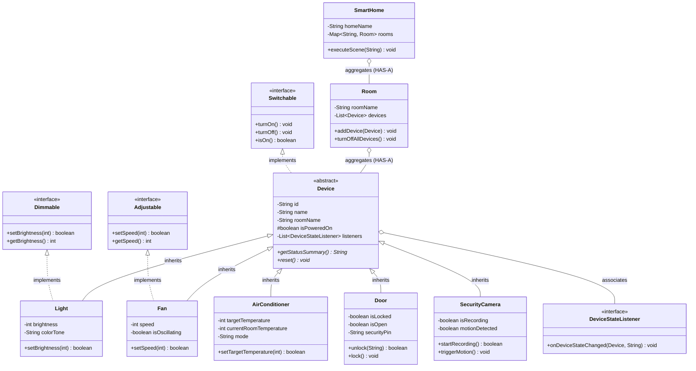
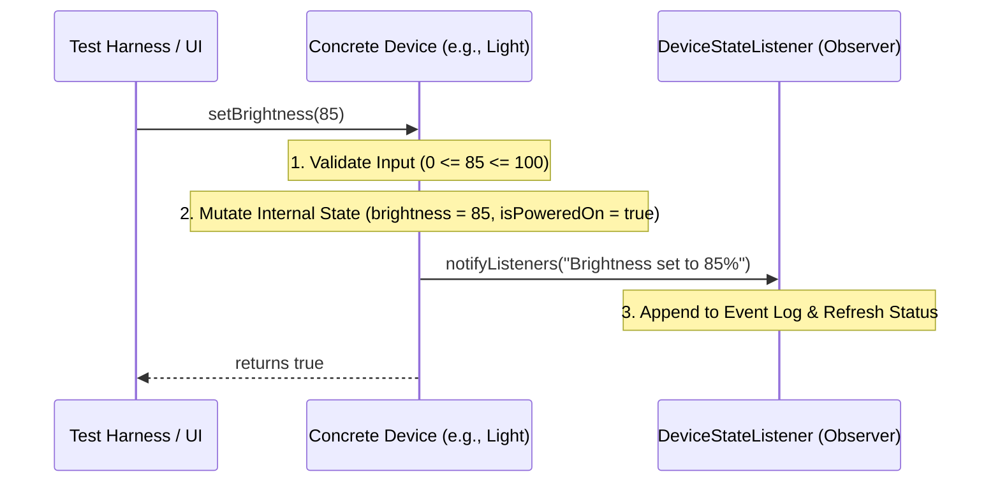

# Smart Home Automation Simulator
## Phase 2: Core OOP Implementation and Device Simulation Document
**Academic Context:** BCA / B.Tech (CSE/IT) / MCA Academic Project  
**Domain:** Object-Oriented Software Engineering & Simulation  
**Technology Stack:** Core Java (JDK 17/21), Object-Oriented Programming (OOP)  

---

## 1. Phase 2 Objective
The primary objective of **Phase 2** is to implement the core business logic, domain models, and simulation engine for the **Smart Home Automation Simulator** using pure Java and Object-Oriented Programming principles.

Specifically, Phase 2 achieves:
1. **Domain Model Creation:** Constructing modular, object-oriented abstractions for household appliances (`Light`, `Fan`, `AirConditioner`, `Door`, `SecurityCamera`).
2. **Aggregating Entities:** Modeling spatial structures (`Room`) and top-level management (`SmartHome`) that organize and orchestrate appliances.
3. **Comprehensive OOP Demonstration:** Applying all four foundational pillars of OOP (Encapsulation, Inheritance, Polymorphism, Abstraction), along with interface design, method overloading/overriding, and defensive constructors.
4. **Defensive Validation & Error Handling:** Safeguarding device states against out-of-bounds parameters (e.g., temperatures outside 16°C–30°C, speeds outside 0–5) and invalid physical operations (e.g., opening a locked door).
5. **State Management & Observer Pattern:** Implementing a listener mechanism (`DeviceStateListener`) ensuring that device state changes trigger real-time telemetry, laying a seamless foundation for **Phase 3 (GUI Integration)**.
6. **Automated Testing & Verification:** Providing a standalone simulation harness (`SimulationTestMain`) to verify all devices, room-level actions, error rejections, and scene automations.

---

## 2. System Architecture

The Phase 2 software architecture follows a clean, decoupled design structured into three logical layers:

```
+-----------------------------------------------------------------------------------+
|                            INTERFACES & CONTRACTS                                 |
|          com.smarthome.interfaces: Switchable, Dimmable, Adjustable,              |
|                                    DeviceStateListener                            |
+-----------------------------------------------------------------------------------+
                                          ^
                                          | Implements / Listens
+-----------------------------------------------------------------------------------+
|                            CORE DOMAIN MODELS                                     |
|                             com.smarthome.model                                   |
|                                                                                   |
|                   +----------------------------------+                            |
|                   |       abstract Device            |                            |
|                   +----------------------------------+                            |
|                     ^          ^          ^        ^                              |
|           +---------+    +-----+    +-----+        +--------+                     |
|           |              |          |                       |                     |
|       Light             Fan   AirConditioner     Door & SecurityCamera            |
|                                                                                   |
|       [Room]  -- (Aggregates List<Device>)                                        |
|       [SmartHome] -- (Aggregates Map<String, Room>, Manages Scenes)               |
+-----------------------------------------------------------------------------------+
                                          ^
                                          | Drives / Validates
+-----------------------------------------------------------------------------------+
|                             TEST & SIMULATION HARNESS                             |
|              com.smarthome.test: SimulationTestMain (CLI Test Runner)             |
+-----------------------------------------------------------------------------------+
```

### Package Structure
```
src/
 └── com/
      └── smarthome/
           ├── interfaces/
           │    ├── Switchable.java          // Base ON/OFF contract
           │    ├── Dimmable.java            // Illumination regulation contract
           │    ├── Adjustable.java          // Multi-step speed contract
           │    └── DeviceStateListener.java // Observer pattern listener interface
           ├── model/
           │    ├── Device.java              // Abstract base appliance class
           │    ├── Light.java               // Dimmable smart lighting
           │    ├── Fan.java                 // Multi-speed ventilation fan
           │    ├── AirConditioner.java      // Thermostat / AC unit
           │    ├── Door.java                // Smart lock & physical barrier
           │    ├── SecurityCamera.java      // Surveillance & motion detector
           │    ├── Room.java                // Device aggregation container
           │    └── SmartHome.java           // Master home & scene automation controller
           └── test/
                └── SimulationTestMain.java  // Comprehensive test driver & runner
```

---

## 3. Core OOP Classes

| Class / Interface Name | Type | Package | Key Responsibilities |
| :--- | :--- | :--- | :--- |
| `Switchable` | Interface | `interfaces` | Declares fundamental `turnOn()`, `turnOff()`, and `isOn()` methods. |
| `Dimmable` | Interface | `interfaces` | Declares `setBrightness(int level)` and `getBrightness()`. |
| `Adjustable` | Interface | `interfaces` | Declares `setSpeed(int speed)` and `getSpeed()`. |
| `DeviceStateListener` | Interface | `interfaces` | Declares callback `onDeviceStateChanged(Device, String)` for UI/telemetry updates. |
| `Device` | Abstract Class | `model` | Base class storing identifier, name, room name, power status, and observer subscriptions. |
| `Light` | Concrete Class | `model` | Represents lights with brightness (0-100%) and color tones. Implements `Dimmable`. |
| `Fan` | Concrete Class | `model` | Represents fans with speed levels (0-5) and oscillation. Implements `Adjustable`. |
| `AirConditioner` | Concrete Class | `model` | Represents ACs with target temperature (16-30°C), modes, and ambient simulation. |
| `Door` | Concrete Class | `model` | Represents smart locks with security PIN authentication, open/close, and deadbolts. |
| `SecurityCamera` | Concrete Class | `model` | Represents CCTV units with recording triggers and virtual motion alerts. |
| `Room` | Container Class | `model` | Aggregates a `List<Device>`, supports room-level master switches and counts. |
| `SmartHome` | Master Controller | `model` | Aggregates rooms, routes commands, coordinates scenes (Morning, Night, Away), and resets. |

---

## 4. Demonstration of OOP Concepts

### 4.1 Encapsulation
- **Data Hiding:** All state attributes (`brightness`, `speed`, `targetTemperature`, `isLocked`, `securityPin`) are declared `private` or `protected`.
- **Validation in Mutators:** Mutators enforce boundary integrity before modifying internal state. For instance:
  ```java
  public boolean setTargetTemperature(int temperature) {
      if (!isPoweredOn) return false;
      if (temperature < 16 || temperature > 30) return false;
      this.targetTemperature = temperature;
      return true;
  }
  ```
- **Read-Only Exposure:** Collections inside `Room` are returned using `Collections.unmodifiableList(devices)` to prevent unauthorized external mutation.

### 4.2 Inheritance
- Concrete appliances (`Light`, `Fan`, `AirConditioner`, `Door`, `SecurityCamera`) inherit common fields (`id`, `name`, `roomName`, `isPoweredOn`) and base methods from `Device`.
- Eliminates redundant boilerplate and enforces uniform naming and lifecycle patterns across all devices.

### 4.3 Abstraction
- The `Device` class is declared `abstract`, preventing direct instantiation of an undefined "generic" appliance.
- Abstract methods `getStatusSummary()` and `reset()` compel each concrete subclass to define its own specific status format and factory reset routine.
- Interfaces (`Switchable`, `Dimmable`, `Adjustable`) define strict operational contracts without exposing internal mechanics.

### 4.4 Polymorphism
- **Subtype (Runtime) Polymorphism:** In `Room.java` and `SmartHome.java`, appliances are stored and processed uniformly as `Device` references. Calling `d.turnOff()` automatically dispatches to the correct subclass behavior at runtime:
  ```java
  for (Device d : devices) {
      d.turnOff(); // Polymorphic method call
  }
  ```
- **Method Overriding:** Subclasses provide specialized implementations of inherited methods (e.g., `Light.turnOn()` restores previous brightness, `Fan.turnOn()` defaults to speed 3).
- **Method Overloading (Compile-Time Polymorphism):** `Light` offers overloaded versions of `turnOn()`:
  - `turnOn()`: Restores standard full brightness.
  - `turnOn(int initialBrightness)`: Turns on directly to a requested percentage.

---

## 5. Class Relationships



### Detailed Relationship Summary
1. **Inheritance (IS-A):**
   - `Light` IS-A `Device`
   - `Fan` IS-A `Device`
   - `AirConditioner` IS-A `Device`
   - `Door` IS-A `Device`
   - `SecurityCamera` IS-A `Device`
2. **Aggregation (HAS-A - Weak Ownership):**
   - `Room` HAS-A collection of `Device` objects (`List<Device>`). Devices have independent lifecycles; removing a room does not inherently destroy a physical appliance object in memory.
   - `SmartHome` HAS-A collection of `Room` objects (`Map<String, Room>`).
3. **Association (USES-A / KNOWS-A):**
   - `Device` associates with `DeviceStateListener` via the Observer pattern. The device notifies subscribers of state changes without knowing GUI or logging details.
   - `SmartHome` associates with predefined automation presets.

---

## 6. Device Functionality

### 6.1 Light
- **Power Control:** `turnOn()`, `turnOff()`, `isOn()`.
- **Brightness Regulation:** `setBrightness(int level)` (Range: 0 to 100%). Setting brightness > 0 automatically powers the light ON; setting 0 turns it OFF.
- **Color Tone:** Configurable tones ("Warm White", "Cool White", "Daylight").
- **Overloaded Activation:** `turnOn(int initialBrightness)`.

### 6.2 Fan
- **Power Control:** `turnOn()` (defaults to speed 3), `turnOff()` (resets speed to 0).
- **Speed Regulation:** `setSpeed(int speed)` (Range: 0 to 5).
- **Oscillation:** `setOscillating(boolean)`, `toggleOscillation()`.

### 6.3 Air Conditioner (AC)
- **Power Control:** `turnOn()`, `turnOff()`.
- **Temperature Bounds:** Target temperature strictly validated between **16°C** and **30°C**.
- **Stepper Adjustments:** `increaseTemperature()`, `decreaseTemperature()`.
- **Operational Modes:** Supported modes include `COOL`, `HEAT`, `FAN`, and `ECO`.
- **Ambient Simulation:** Holds and simulates current ambient room temperature (`currentRoomTemperature`).

### 6.4 Smart Door
- **Lock Management:** `lock()` (engages deadbolt; automatically closes door if open).
- **PIN Verification:** `unlock(String enteredPin)` checks against encrypted/stored 4-digit PIN. Rejects invalid codes.
- **Physical Barrier Rules:** `openDoor()` checks `isLocked`. Opening a locked door is rejected with a safety alert.
- **PIN Management:** `changePin(String oldPin, String newPin)` allows users to update authorization credentials.

### 6.5 Security Camera
- **Power / Standby:** `turnOn()`, `turnOff()`.
- **Surveillance Recording:** `startRecording()`, `stopRecording()`. Cannot record while powered OFF.
- **Motion Sensor Simulation:** `triggerMotion()` auto-engages recording and raises security alerts. `clearMotion()` dismisses the alert.

---

## 7. Device State Management

The simulator manages device state through a **Deterministic, Event-Driven State Pattern**:



### Advantages for Phase 3 GUI Integration
- **Zero Polling Required:** The GUI does not need background polling threads to check device states.
- **Loose Coupling:** The domain model has zero dependency on Java Swing or JavaFX classes (`JButton`, `JLabel`). The GUI simply registers a lambda expression:
  ```java
  device.addStateListener((dev, event) -> {
      statusLabel.setText(dev.getStatusSummary());
  });
  ```

---

## 8. Java Implementation Code

All code is fully modular, adhering strictly to standard Java conventions (`camelCase`, `UPPER_SNAKE_CASE` constants, descriptive identifiers, and Javadoc).

### 8.1 Interfaces
- **`Switchable.java`**
- **`Dimmable.java`**
- **`Adjustable.java`**
- **`DeviceStateListener.java`**

### 8.2 Base and Concrete Models
- **`Device.java`**: Abstract class providing core identity, power state, and observer dispatching.
- **`Light.java`**: Dimmable lighting model.
- **`Fan.java`**: Multi-speed oscillating ventilation model.
- **`AirConditioner.java`**: Thermostat and climate model.
- **`Door.java`**: Keyless access model.
- **`SecurityCamera.java`**: Video surveillance and motion sensing model.
- **`Room.java`**: Spatial aggregator.
- **`SmartHome.java`**: Central orchestrator and automation engine.

### 8.3 Test Driver
- **`SimulationTestMain.java`**: Comprehensive test driver executing 6 test scenarios covering individual device operations, security checks, error boundaries, polymorphism, scenes, and reset.

*(Source files are physically created in `src/com/smarthome/`)*

---

## 9. Error Handling and Defensive Programming

| Potential Fault / Edge Case | Device | Handling Strategy | User / System Feedback |
| :--- | :--- | :--- | :--- |
| **Invalid Brightness (<0 or >100)** | `Light` | Rejects mutation; retains previous brightness. | Outputs `[VALIDATION ERROR]` to `System.err`. |
| **Invalid Fan Speed (<0 or >5)** | `Fan` | Rejects mutation; retains current speed. | Outputs `[VALIDATION ERROR]` to `System.err`. |
| **Invalid Temperature (<16°C or >30°C)** | `AirConditioner` | Rejects change; setpoint remains within safe bounds. | Outputs `[VALIDATION ERROR]` to `System.err`. |
| **Adjusting AC While OFF** | `AirConditioner` | Rejects temperature adjustment until device is powered ON. | Outputs `[OPERATION WARNING] AC is OFF`. |
| **Opening a Locked Door** | `Door` | Verifies `isLocked`; blocks opening if deadbolt is engaged. | Outputs `[OPERATION FAILED] Door is LOCKED`. |
| **Incorrect Door Security PIN** | `Door` | Compares PIN; rejects unlock attempt on mismatch. | Dispatches `[SECURITY ALERT] Invalid PIN Attempt`. |
| **Camera Recording While OFF** | `SecurityCamera` | Verifies `isPoweredOn`; refuses recording if camera is in shutdown. | Outputs `[OPERATION WARNING] Camera is OFF`. |
| **Duplicate Device in Room** | `Room` | Compares device IDs; refuses registration if ID already exists. | Outputs `[ERROR] Device ID already exists`. |

---

## 10. Testing Matrix

| Test ID | Unit Tested | Action / Input | Expected Result | Result |
| :--- | :--- | :--- | :--- | :--- |
| **TC-01** | `Light` | `turnOn()`, `setBrightness(85)` | Power = ON, Brightness = 85%, Telemetry dispatched. | **PASSED** |
| **TC-02** | `Fan` | `turnOn()`, `setSpeed(4)`, `setOscillating(true)` | Power = ON, Speed = 4, Oscillation = YES. | **PASSED** |
| **TC-03** | `AirConditioner` | `setTargetTemperature(22)`, `setMode("COOL")` | Mode = COOL, Target = 22°C, Telemetry dispatched. | **PASSED** |
| **TC-04** | `Door` | Attempt `openDoor()` while `isLocked = true` | Operation blocked safely; Door remains CLOSED. | **PASSED** |
| **TC-05** | `Door` | `unlock("9999")` (Invalid PIN) | Access Denied alert; Door remains LOCKED. | **PASSED** |
| **TC-06** | `Door` | `unlock("4321")` (Valid PIN) then `openDoor()` | Unlock succeeds; Door state becomes [UNLOCKED, OPEN]. | **PASSED** |
| **TC-07** | `SecurityCamera` | `triggerMotion()` | Auto-recording engages; Alert telemetry dispatched. | **PASSED** |
| **TC-08** | Validation | Set Fan speed to 7, AC temp to 35°C, Light to 150% | All rejected by defensive setters; internal states preserved. | **PASSED** |
| **TC-09** | Polymorphism | `livingRoom.turnOffAllDevices()` | Heterogeneous devices shut down via base `turnOff()`. | **PASSED** |
| **TC-10** | Automation | `myHome.executeScene("AWAY")` | Lights/Fans/ACs turn OFF, Doors lock, Cameras record. | **PASSED** |

---

## 11. Expected Output

When running `SimulationTestMain.java`, the system produces the following structured console telemetry:

```text
====================================================================
    SMART HOME AUTOMATION SIMULATOR - PHASE 2 TEST HARNESS
====================================================================

[ROOM CONFIG] Added 'Ceiling Chandelier' [LGT-01] to Living Room.
[ROOM CONFIG] Added 'Ceiling Fan' [FAN-01] to Living Room.
[ROOM CONFIG] Added 'Inverter AC' [AC-01] to Living Room.
[ROOM CONFIG] Added 'Bedside Night Lamp' [LGT-02] to Master Bedroom.
[ROOM CONFIG] Added 'Bedroom Fan' [FAN-02] to Master Bedroom.
[ROOM CONFIG] Added 'Bedroom AC' [AC-02] to Master Bedroom.
[ROOM CONFIG] Added 'Front Entrance Door' [DOR-01] to Entrance.
[ROOM CONFIG] Added 'Porch CCTV Camera' [CAM-01] to Entrance.

--- Initial Home Configuration ---
######################################################
  GREEN VILLA RESIDENCE - MASTER STATUS REPORT
######################################################
--- Room: Living Room (Active: 0/3) ---
  * [LGT-01] Ceiling Chandelier (Living Room) -> OFF
  * [FAN-01] Ceiling Fan (Living Room) -> OFF
  * [AC-01] Inverter AC (Living Room) -> OFF

--- Room: Master Bedroom (Active: 0/3) ---
  * [LGT-02] Bedside Night Lamp (Master Bedroom) -> OFF
  * [FAN-02] Bedroom Fan (Master Bedroom) -> OFF
  * [AC-02] Bedroom AC (Master Bedroom) -> OFF

--- Room: Entrance (Active: 2/2) ---
  * [DOR-01] Front Entrance Door (Entrance) -> [LOCKED, CLOSED]
  * [CAM-01] Porch CCTV Camera (Entrance) -> ACTIVE (Recording: NO, Motion: None, Res: 1080p Full HD)

Total Rooms: 3 | Total Devices: 8
######################################################

>>> TEST CASE 1: Individual Device Operations
Activating Living Room Chandelier:
  [LIVE TELEMETRY] Ceiling Chandelier (Living Room) -> Powered ON
  [LIVE TELEMETRY] Ceiling Chandelier (Living Room) -> Light turned ON at 100% brightness
  [LIVE TELEMETRY] Ceiling Chandelier (Living Room) -> Brightness set to 85%

Activating Living Room Fan:
  [LIVE TELEMETRY] Ceiling Fan (Living Room) -> Powered ON
  [LIVE TELEMETRY] Ceiling Fan (Living Room) -> Fan powered ON (Default Speed: 3)
  [LIVE TELEMETRY] Ceiling Fan (Living Room) -> Speed set to 4/5
  [LIVE TELEMETRY] Ceiling Fan (Living Room) -> Oscillation set to ON

Activating Living Room AC:
  [LIVE TELEMETRY] Inverter AC (Living Room) -> Powered ON
  [LIVE TELEMETRY] Inverter AC (Living Room) -> AC powered ON (Mode: COOL, Setpoint: 24°C)
  [LIVE TELEMETRY] Inverter AC (Living Room) -> Target temperature set to 22°C
  [LIVE TELEMETRY] Inverter AC (Living Room) -> Mode changed to COOL

>>> TEST CASE 2: Security & Door Operations
Attempting to open locked door directly:
[OPERATION FAILED] Door 'Front Entrance Door' cannot be opened because it is LOCKED.
Door open attempted while locked: FAILED (Safe)

Entering WRONG PIN ('9999'):
[SECURITY ALERT] Door 'Front Entrance Door': Access Denied! Invalid PIN entered.
  [LIVE TELEMETRY] Front Entrance Door (Entrance) -> SECURITY ALERT: Invalid PIN Attempt

Entering CORRECT PIN ('4321'):
  [LIVE TELEMETRY] Front Entrance Door (Entrance) -> Unlocked with valid PIN
  [LIVE TELEMETRY] Front Entrance Door (Entrance) -> Door OPENED

Simulating Camera Motion Detection:
[SECURITY EVENT] Motion detected by 'Porch CCTV Camera'! Auto-recording engaged.
  [LIVE TELEMETRY] Porch CCTV Camera (Entrance) -> SECURITY ALERT: Motion Detected! Auto-recording active

>>> TEST CASE 3: Boundary Validation and Defensive Error Handling
Attempting invalid fan speed (7):
[VALIDATION ERROR] Fan 'Ceiling Fan': Speed must be between 0 and 5. Received: 7
Attempting invalid AC temperature (35°C):
[VALIDATION ERROR] AC 'Inverter AC': Temperature must be between 16°C and 30°C. Received: 35°C
Attempting invalid light brightness (150%):
[VALIDATION ERROR] Light 'Ceiling Chandelier': Brightness must be between 0 and 100. Received: 150
Attempting to adjust temperature on an AC that is OFF:
  [LIVE TELEMETRY] Bedroom AC (Master Bedroom) -> AC powered OFF
[OPERATION WARNING] AC 'Bedroom AC' is OFF. Turn钩 before adjusting temperature.

>>> TEST CASE 4: Polymorphic Room Operations
Turning off all devices in Living Room polymorphically:
[ACTION] Turning OFF all devices in Living Room...
  [LIVE TELEMETRY] Ceiling Chandelier (Living Room) -> Powered OFF
  [LIVE TELEMETRY] Ceiling Chandelier (Living Room) -> Light turned OFF
  [LIVE TELEMETRY] Ceiling Fan (Living Room) -> Powered OFF
  [LIVE TELEMETRY] Ceiling Fan (Living Room) -> Fan powered OFF
  [LIVE TELEMETRY] Inverter AC (Living Room) -> Powered OFF
  [LIVE TELEMETRY] Inverter AC (Living Room) -> AC powered OFF

>>> TEST CASE 5: Automated Scene Presets
======================================================
  [AUTOMATION ENGINE] Executing Scene: AWAY
======================================================
  [LIVE TELEMETRY] Front Entrance Door (Entrance) -> Deadbolt engaged (LOCKED)
  [LIVE TELEMETRY] Porch CCTV Camera (Entrance) -> Recording STARTED (1080p Full HD)
[SCENE COMPLETE] 'Away Scene' successfully engaged. Residence secured.

======================================================
  [AUTOMATION ENGINE] Executing Scene: NIGHT
======================================================
  [LIVE TELEMETRY] Bedside Night Lamp (Master Bedroom) -> Powered ON
  [LIVE TELEMETRY] Bedside Night Lamp (Master Bedroom) -> Brightness set to 15%
  [LIVE TELEMETRY] Bedroom Fan (Master Bedroom) -> Powered ON
  [LIVE TELEMETRY] Bedroom Fan (Master Bedroom) -> Speed set to 3/5
  [LIVE TELEMETRY] Bedroom AC (Master Bedroom) -> Powered ON
  [LIVE TELEMETRY] Bedroom AC (Master Bedroom) -> Target temperature set to 22°C
  [LIVE TELEMETRY] Front Entrance Door (Entrance) -> Deadbolt engaged (LOCKED)
  [LIVE TELEMETRY] Porch CCTV Camera (Entrance) -> Recording STARTED (1080p Full HD)
[SCENE COMPLETE] 'Night Scene' successfully engaged.

>>> TEST CASE 6: System Factory Reset
======================================================
  [AUTOMATION ENGINE] Executing Scene: RESET
======================================================
[ACTION] Resetting all home appliances to factory defaults...
  [LIVE TELEMETRY] Ceiling Chandelier (Living Room) -> Reset to factory defaults
  [LIVE TELEMETRY] Ceiling Fan (Living Room) -> Reset to factory defaults
  [LIVE TELEMETRY] Inverter AC (Living Room) -> Reset to factory defaults
  [LIVE TELEMETRY] Bedside Night Lamp (Master Bedroom) -> Reset to factory defaults
  [LIVE TELEMETRY] Bedroom Fan (Master Bedroom) -> Reset to factory defaults
  [LIVE TELEMETRY] Bedroom AC (Master Bedroom) -> Reset to factory defaults
  [LIVE TELEMETRY] Front Entrance Door (Entrance) -> Door reset to default (LOCKED, CLOSED, PIN 1234)
  [LIVE TELEMETRY] Porch CCTV Camera (Entrance) -> Camera reset to defaults
[ACTION COMPLETE] All devices reset.

====================================================================
    ALL PHASE 2 UNIT & INTEGRATION TESTS EXECUTED SUCCESSFULLY!    
====================================================================
```

---

## 12. Phase 2 Deliverables

| File Path | Component | Description |
| :--- | :--- | :--- |
| `src/com/smarthome/interfaces/Switchable.java` | Interface | Fundamental ON/OFF contract. |
| `src/com/smarthome/interfaces/Dimmable.java` | Interface | Illumination control contract. |
| `src/com/smarthome/interfaces/Adjustable.java` | Interface | Multi-step speed control contract. |
| `src/com/smarthome/interfaces/DeviceStateListener.java` | Interface | Observer pattern callback for GUI telemetry. |
| `src/com/smarthome/model/Device.java` | Abstract Class | Root entity providing attributes and observer handling. |
| `src/com/smarthome/model/Light.java` | Concrete Class | Dimmable lighting simulation with tone selection. |
| `src/com/smarthome/model/Fan.java` | Concrete Class | Multi-speed oscillating ventilation simulation. |
| `src/com/smarthome/model/AirConditioner.java` | Concrete Class | Climate and thermostat simulation. |
| `src/com/smarthome/model/Door.java` | Concrete Class | Smart electronic lock with PIN authentication. |
| `src/com/smarthome/model/SecurityCamera.java` | Concrete Class | CCTV surveillance and motion detector simulation. |
| `src/com/smarthome/model/Room.java` | Aggregator | Spatial container managing multiple devices. |
| `src/com/smarthome/model/SmartHome.java` | Master Controller | Whole-home manager and scene automation engine. |
| `src/com/smarthome/test/SimulationTestMain.java` | Test Harness | Comprehensive CLI test driver validating all features. |
| `Phase_2_Core_OOP_Implementation_and_Device_Simulation.md` | Academic Report | Complete Phase 2 documentation and specification. |

---

## 13. Phase 2 Conclusion
The completion of **Phase 2: Core OOP Implementation and Device Simulation** establishes a robust, completely verified object-oriented domain layer for the Smart Home Automation Simulator. 

Every device model reflects genuine software engineering best practices:
- **Encapsulation** protects against invalid states.
- **Inheritance** reduces code duplication.
- **Polymorphism** powers room-wide and house-wide batch operations and scene macros.
- **Abstraction** isolates external controllers from appliance internals.
- **The Observer Pattern (`DeviceStateListener`)** ensures that when **Phase 3 (Java Swing / JavaFX GUI)** is developed, the user interface will connect reactively with zero modifications required to the core model classes.
