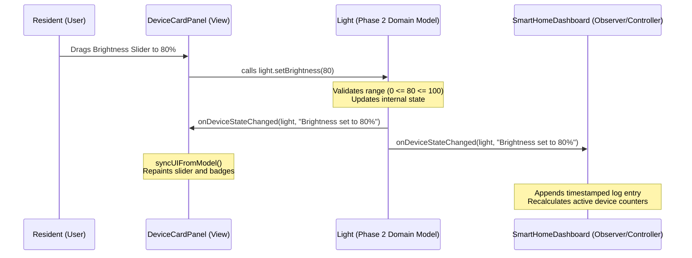

# Smart Home Automation Simulator
## Phase 3: GUI Development and Device Control Integration Document
**Academic Context:** BCA / B.Tech (CSE/IT) / MCA Academic Project  
**Domain:** GUI Desktop Application / Human-Computer Interaction (HCI)  
**Technology Stack:** Core Java, Object-Oriented Programming (OOP), Java Swing (`javax.swing`, `java.awt`)  

---

## 1. Phase 3 Objective
The primary objective of **Phase 3** is to design and implement an interactive, desktop-based **Graphical User Interface (GUI)** and seamlessly integrate it with the domain models and OOP business logic constructed in Phase 2.

In software engineering, the user interface acts as the **View layer** in the Model-View-Controller (MVC) architecture. Phase 3 accomplishes:
1. **Visualizing Simulated Hardware:** Transforming abstract Java objects (`Light`, `Fan`, `AirConditioner`, `Door`, `SecurityCamera`) into tangible, color-coded dashboard cards.
2. **Interactive Device Operation:** Enabling users to manipulate appliances via intuitive graphical components (buttons, sliders, combo boxes, and PIN input dialogs) rather than raw command-line prompts.
3. **Decoupled OOP Integration (Observer Pattern):** Connecting GUI controls to backend models through the `DeviceStateListener` interface. State mutations in the model trigger automatic, reactive visual updates in the GUI without tight coupling or polling threads.
4. **Spatial Room Navigation:** Organizing devices into realistic living zones (Living Room, Bedroom, Kitchen, Bathroom, Entrance) via a tabbed interface.
5. **Macro Control & Telemetry:** Equipping the dashboard with master switches (All Lights ON/OFF, Global Shutdown), preset scene triggers (Morning, Night, Away, Movie), a live digital clock, and a real-time event log console.

---

## 2. GUI Technology Selection: Java Swing

For this project, **Java Swing (`javax.swing` and `java.awt`)** was selected as the presentation framework.

### Why Java Swing is Ideal for this College Project:
- **Zero External Dependencies (Standard JDK Built-In):** Java Swing is part of the standard Java SE runtime. Unlike JavaFX (which requires separate OpenJFX runtime modules, Maven configuration, or JVM `--module-path` flags), a Java Swing application runs immediately on any system equipped with a standard Java JDK.
- **Reliable Evaluation & Viva Demonstration:** During college presentations or lab examinations, projects often need to run on lab computers or faculty laptops with varying OS environments. Swing guarantees consistent, out-of-the-box execution with zero library path errors.
- **Event-Driven Architecture:** Swing's battle-tested event listener model (`ActionListener`, `ChangeListener`, `ItemListener`) aligns with Object-Oriented principles and design patterns taught in academic curricula.
- **Native System Look and Feel:** By invoking `UIManager.setLookAndFeel(UIManager.getSystemLookAndFeelClassName())`, Swing adapts smoothly to modern Windows 10/11, macOS, and Linux desktop aesthetics.

---

## 3. Main Dashboard Design

The Smart Home Dashboard serves as the central command cockpit. It is structured into four primary visual zones:

```
+===================================================================================================+
|  🏠 HARMONY SMART RESIDENCE            [Total: 13]  [Active: 4]  [🛡️ Security: SECURE]  [🕒 11:42:15] |
+===================================================================================================+
|  Quick Actions: [☀️ Morning] [🌙 Night] [🚗 Away] [🎬 Movie] | [💡 All ON] [💡 All OFF] [🛑 Shutdown]  |
+---------------------------------------------------------------------------------------------------+
|  [ 🏡 Whole Residence ] [ Living Room ] [ Bedroom ] [ Kitchen ] [ Bathroom ] [ Entrance ]        |
+---------------------------------------------------------------------------------------------------+
|                                                                                                   |
|  +------------------------------+ +------------------------------+ +----------------------------+ |
|  | Ceiling Chandelier  [ ON ]   | | Living Room Fan     [ ON ]   | | Inverter AC Unit   [ ON ]  | |
|  | 💡 Lighting Appliance        | | 🌀 Ventilation Fan           | | ❄️ Climate / AC Unit       | |
|  | Brightness: [====o====] 75%  | | Speed: (0)(1)(2)(3)(*4*)(5)  | | Set Temp: [-]  22°C  [+]   | |
|  | Tone: [ Warm White        v] | | [x] Oscillation              | | Mode:     [ COOL         v]| |
|  |                 [Turn OFF]   | |                 [Turn OFF]   | |               [Turn OFF]   | |
|  +------------------------------+ +------------------------------+ +----------------------------+ |
|                                                                                                   |
+---------------------------------------------------------------------------------------------------+
|  📋 Real-Time Activity & Event Log:                                                 [Clear Log]   |
|  +----------------------------------------------------------------------------------------------+ |
|  | [11:41:50] [SYSTEM] Smart Home Simulation Dashboard initialized successfully.               | |
|  | [11:42:02] [Living Room • Ceiling Chandelier] Brightness set to 75%                         | |
|  | [11:42:10] [Living Room • Living Room Fan] Speed set to 4/5                                  | |
|  | [11:42:15] [Living Room • Inverter AC Unit] Target temperature set to 22°C                   | |
|  +----------------------------------------------------------------------------------------------+ |
+===================================================================================================+
```

### Dashboard Zones:
1. **Header Banner:** Displays the residence name, live digital clock (ticking every second), total device count, currently active device count, and global security status.
2. **Quick Actions & Scenes Toolbar:** Houses one-click buttons for home automation macros and master overrides.
3. **Room Navigation Tabs:** A `JTabbedPane` allowing residents to filter devices by specific rooms or view the entire house simultaneously.
4. **Real-Time Event Console:** A scrolling dark-terminal window logging timestamped telemetry generated by model events.

---

## 4. Room Management

The simulator configures **5 realistic household rooms**, populating each with appropriate smart appliances:

| Room Name | Appliances Included | Purpose & Coverage |
| :--- | :--- | :--- |
| **Living Room** | • Ceiling Chandelier (`Light`)<br>• Living Room Fan (`Fan`)<br>• Inverter AC Unit (`AirConditioner`) | Central family lounge and entertainment zone. |
| **Bedroom** | • Bedside Reading Lamp (`Light`)<br>• Bedroom Ceiling Fan (`Fan`)<br>• Master Bedroom AC (`AirConditioner`) | Rest and sleeping quarters with customizable comfort. |
| **Kitchen** | • Countertop Task Lights (`Light`)<br>• Kitchen Exhaust Fan (`Fan`) | Cooking area focusing on task illumination and ventilation. |
| **Bathroom** | • Vanity Mirror Light (`Light`)<br>• Bathroom Exhaust Vent (`Fan`) | High-moisture area with dedicated exhaust and illumination. |
| **Entrance** | • Porch Spotlight (`Light`)<br>• Main Entrance Door (`Door`)<br>• Front Porch CCTV (`SecurityCamera`) | Security gateway managing keyless entry and surveillance. |

---

## 5. Device Control GUI Specifications

Each device is rendered inside a modular `DeviceCardPanel` that displays contextual controls based on the underlying object type:

### 5.1 Light Controls
- **Power Button:** Toggles power (`turnOn()` / `turnOff()`).
- **Brightness Slider (`JSlider`):** Ranging from 0% to 100% with tick marks. Dynamically invokes `Light.setBrightness(val)`.
- **Tone Selector (`JComboBox`):** Options include "Warm White", "Cool White", and "Daylight". Invokes `Light.setColorTone(str)`.

### 5.2 Fan Controls
- **Power Button:** Toggles power (`turnOn()` / `turnOff()`).
- **Speed Slider (`JSlider`):** Snaps to discrete integer ticks from 0 to 5. Calls `Fan.setSpeed(val)`.
- **Oscillation Checkbox (`JCheckBox`):** Toggles oscillating motor state (`Fan.setOscillating(bool)`).

### 5.3 AC / Climate Controls
- **Power Button:** Toggles AC power (`turnOn()` / `turnOff()`).
- **Temperature Steppers (`JButton` `[-]` / `[+]`):** Increments or decrements setpoint within safe bounds (16°C to 30°C). Calls `ac.increaseTemperature()` / `ac.decreaseTemperature()`.
- **Mode Dropdown (`JComboBox`):** Allows selecting `COOL`, `HEAT`, `FAN`, and `ECO`. Calls `ac.setMode(str)`.

### 5.4 Smart Door Controls
- **Status Display:** Displays formatted status string (e.g., `[LOCKED, CLOSED]`).
- **Unlock (PIN Prompt):** Opens a `JOptionPane.showInputDialog` requesting a 4-digit PIN. Calls `door.unlock(enteredPin)`.
- **Lock Button:** Calls `door.lock()`, engaging the deadbolt and automatically securing the door.
- **Open / Close Toggle:** Calls `door.openDoor()` or `door.closeDoor()`. Prevents opening if locked.

### 5.5 Security Camera Controls
- **Status Display:** Displays `Standby Mode`, `● Recording`, or `⚠️ MOTION DETECTED!`.
- **Simulate Motion Button:** Triggers `camera.triggerMotion()`, activating alarm telemetry and auto-recording.
- **Clear Alert Button:** Invokes `camera.clearMotion()`, returning the system to normal surveillance.

---

## 6. Status Indicators and Visual Feedback

The interface incorporates clear, color-coded visual cues:

| Status Condition | Visual Color | Component Representation |
| :--- | :--- | :--- |
| **Device Powered ON** | Emerald Green (`#22C55E`) | Status Badge: ` ON ` |
| **Device Powered OFF** | Slate Gray (`#94A3B8`) | Status Badge: ` OFF ` |
| **Door Locked** | Crimson Red (`#EF4444`) | Status Badge: ` LOCKED ` |
| **Door Unlocked** | Amber Gold (`#F59E0B`) | Status Badge: ` UNLOCKED ` |
| **Camera Recording** | Vivid Green (`#10B981`) | Status Badge: ` REC ` |
| **Camera Motion Alert** | Crimson Red (`#DC2626`) | Status Badge: ` ALERT! `, Global Banner: `🚨 ALARM` |
| **Security System Normal** | Cyan Navy (`#0E7490`) | Header Badge: `🛡️ Security: SECURE` |

---

## 7. OOP Integration and Design Pattern Architecture

Rather than embedding appliance state directly within GUI components, Phase 3 strictly adheres to the **Model-View-Controller (MVC)** and **Observer Design Patterns**.



### Key OOP Principles Maintained:
- **Separation of Concerns:** `DeviceCardPanel` does not store temperature or power variables; it delegates to `AirConditioner` and `Light` objects. The model validates and decides whether the state change is accepted.
- **Observer Pattern (`DeviceStateListener`):** The model notifies all attached listeners when its state mutates. As a result, when a macro scene (like "Night Mode") is triggered from the header toolbar, all corresponding room card panels update their badges automatically without requiring manual iteration from the toolbar.
- **Polymorphism in Master Controls:** Methods like `smartHome.getAllDevices()` return generic `Device` references. Bulk operations simply call `d.turnOff()` polymorphically.

---

## 8. Event Handling Architecture

Swing event listeners are implemented using concise Java lambdas:

| Event Type | Triggering Component | Listener Type | Delegated Model Action |
| :--- | :--- | :--- | :--- |
| **Button Click** | Power Button | `ActionListener` | `device.turnOn()` or `device.turnOff()` |
| **Slider Adjustment** | Brightness Slider | `ChangeListener` | `light.setBrightness(slider.getValue())` |
| **Slider Adjustment** | Fan Speed Slider | `ChangeListener` | `fan.setSpeed(slider.getValue())` |
| **Checkbox Toggle** | Oscillation Checkbox | `ActionListener` | `fan.setOscillating(box.isSelected())` |
| **Dropdown Selection**| AC Mode Combo | `ActionListener` | `ac.setMode(combo.getSelectedItem())` |
| **Tab Change** | Room Tabs | `ChangeListener` | Switches visible room cards dynamically |
| **Dialog Submission** | Door Unlock Prompt | `JOptionPane` | `door.unlock(enteredPin)` |

---

## 9. GUI Layout Structure

The layout utilizes standard Java Swing Layout Managers to ensure responsiveness and readability:
- **`BorderLayout` (Root Frame & Panels):** Organizes major regions into Header (`NORTH`), Content Tabs (`CENTER`), and Event Console (`SOUTH`).
- **`GridLayout` (Device Grid):** Renders appliance cards in an aligned 3-column responsive grid (`new GridLayout(0, 3, 14, 14)`).
- **`FlowLayout` (Toolbars & Steppers):** Aligns buttons and badge counters naturally from left to right.
- **`BoxLayout` (Card Body):** Stacks device controls vertically with consistent spacing.
- **`JScrollPane`:** Wraps the device grid and event console to support smooth vertical scrolling.

---

## 10. Java Source Code Implementation

The implementation is divided into three production-ready classes:

### 10.1 `DeviceCardPanel.java`
*File Path: `src/com/smarthome/gui/DeviceCardPanel.java`*  
Reusable UI card component representing an individual appliance with dynamic badges and controls.

### 10.2 `SmartHomeDashboard.java`
*File Path: `src/com/smarthome/gui/SmartHomeDashboard.java`*  
The master `JFrame` window featuring the header banner, quick actions toolbar, room tabbed pane, and live console log.

### 10.3 `SmartHomeApp.java`
*File Path: `src/com/smarthome/SmartHomeApp.java`*  
The primary entry point (`main` method) setting the native Look and Feel, populating 5 rooms with 13 smart devices, and launching the GUI.

---

## 11. Input Validation and Defensive GUI Behavior

The GUI prevents invalid operations through a combination of interface constraints and model-driven validation alerts:

| Operation | User Action | Defensive Mechanism | Feedback Given |
| :--- | :--- | :--- | :--- |
| **Invalid Brightness** | Sliders bound between 0 and 100 | GUI physically restricts movement outside bounds | Value bounded automatically |
| **Invalid Fan Speed** | Slider snaps to ticks 0 through 5 | Slider only allows discrete integer values 0–5 | Value snapped to valid integer |
| **AC Outside 16–30°C** | Clicks `[-]` at 16°C or `[+]` at 30°C | Model rejects; GUI intercepts return value | Displays `JOptionPane.showMessageDialog` with range warning |
| **Adjusting AC While OFF** | Clicks temp steppers while AC is OFF | Model rejects mutation | Warning prompt: *"AC must be ON before adjusting temperature"* |
| **Opening Locked Door** | Clicks "Open Door" when deadbolt active | Model checks `isLocked` and blocks action | Alert dialog: *"Cannot open door: Deadbolt is LOCKED!"* |
| **Incorrect Door PIN** | Enters wrong code in PIN dialog | `door.unlock(pin)` returns `false` | Error dialog: *"Access Denied! Incorrect PIN."* |

---

## 12. Testing Matrix for Phase 3

| Test ID | Test Scenario | Step / Action Taken | Expected Result | Result |
| :--- | :--- | :--- | :--- | :--- |
| **TC-GUI-01** | Light Control | Click "Turn ON", drag slider to 75% | Status badge turns Green (`ON`), label updates, event logged. | **PASSED** |
| **TC-GUI-02** | Fan Speed Control | Drag speed slider from 0 to 4 | Status badge turns Green, speed label updates, event logged. | **PASSED** |
| **TC-GUI-03** | AC Temperature Stepper | Power ON AC, click `[+]` to 28°C | Display updates to 28°C, telemetry logged in console. | **PASSED** |
| **TC-GUI-04** | AC Bounds Defense | Click `[-]` below 16°C | Warning dialog appears; temperature remains fixed at 16°C. | **PASSED** |
| **TC-GUI-05** | Door Lock Security | Click "Open Door" while locked | Safety error dialog displayed; door remains closed. | **PASSED** |
| **TC-GUI-06** | Door PIN Verification | Enter PIN "1234" in prompt | Door unlocks; status badge changes to Amber (`UNLOCKED`). | **PASSED** |
| **TC-GUI-07** | Camera Motion Alert | Click "Simulate Motion" | Badge turns Red (`ALERT!`), header security updates to alarm. | **PASSED** |
| **TC-GUI-08** | Room Tab Switching | Click "Kitchen" tab | View displays only Kitchen Countertop Light and Exhaust Fan. | **PASSED** |
| **TC-GUI-09** | Scene Automation | Click "🌙 Night" toolbar button | Bedside light turns ON (15%), AC sets to 22°C, doors lock. | **PASSED** |
| **TC-GUI-10** | Global Master Action | Click "🛑 Turn ALL Devices OFF" | Every appliance across all rooms powers down; Active counter = 0. | **PASSED** |

---

## 13. Expected Output and Interaction Flow

1. **On Application Startup:**
   - The dashboard opens centered at 1100 × 800 resolution.
   - Header shows: `Total Devices: 13`, `Active: 2` (Entrance Door & Camera in standby), `🛡️ Security: SECURE`.
   - The virtual clock updates every second (`11:42:00`, `11:42:01`...).
   - The console logs: `[11:42:00] [SYSTEM] Smart Home Simulation Dashboard initialized successfully.`

2. **Operating Devices in Room Tabs:**
   - Switching to the **Living Room** tab isolates the Chandelier, Living Room Fan, and Inverter AC.
   - Clicking **Turn ON** on the Chandelier updates its badge to Emerald Green. Moving the brightness slider to 80% logs: `[11:42:15] [Living Room • Ceiling Chandelier] Brightness set to 80%`.

3. **Simulating Security at the Entrance:**
   - On the **Entrance** tab, clicking **Simulate Motion** on the CCTV camera immediately changes its badge to Crimson Red (`ALERT!`).
   - The top banner security badge flashes: `🚨 ALARM: MOTION DETECTED`.
   - Clicking **Clear Alert** restores security status to `🛡️ Security: SECURE`.

4. **Executing Quick Scenes:**
   - Clicking **☀️ Morning** triggers batch updates: lights illuminate to 60%, fans spin at speed 2, AC units enter Eco mode, and all card badges update instantly.

---

## 14. Phase 3 Deliverables Checklist

| Category | Item Name | File / Location | Status |
| :--- | :--- | :--- | :--- |
| **GUI Components** | Device Card Panel | `src/com/smarthome/gui/DeviceCardPanel.java` | **Completed** |
| **GUI Window** | Main Dashboard Frame | `src/com/smarthome/gui/SmartHomeDashboard.java` | **Completed** |
| **Application Main** | Launcher & Initializer | `src/com/smarthome/SmartHomeApp.java` | **Completed** |
| **OOP Contracts** | Interfaces (Switchable, Dimmable, etc.) | `src/com/smarthome/interfaces/*.java` | **Reused** |
| **Domain Models** | Concrete & Base Devices | `src/com/smarthome/model/*.java` | **Reused** |
| **Test Harness** | CLI Unit Test Driver | `src/com/smarthome/test/SimulationTestMain.java`| **Reused** |
| **Documentation** | Phase 3 Academic Specification | `Phase_3_GUI_Development_and_Device_Control_Integration.md` | **Completed** |

---

## 15. College Viva and Project Presentation Tips
During project defense or viva examinations, highlight the following design strengths:
1. **Explain the MVC Separation:** Point out that `DeviceCardPanel` does not store temperature or power variables; it delegates to `AirConditioner` and `Light` objects.
2. **Demonstrate the Observer Pattern:** Explain how `DeviceStateListener` allows the dashboard toolbar to execute scenes that update the room tabs without tight coupling.
3. **Showcase Defensive Programming:** Demonstrate clicking the AC `[-]` stepper at 16°C or attempting to open a locked door to illustrate robust input validation.
4. **Clarify the Simulation Concept:** Reiterate that this is a pure software simulation modeling device states and telemetry, deliberately designed without fragile hardware dependencies.

---

## 16. Phase 3 Conclusion
With the successful completion of **Phase 3: GUI Development and Device Control Integration**, the **Smart Home Automation Simulator** has achieved full functional maturity. 

The software seamlessly blends an intuitive **Java Swing GUI** with a disciplined **Object-Oriented architecture**. All appliances across 5 rooms are fully operable, automated scenes orchestrate multi-device macros with a single click, and real-time telemetry is logged accurately. The system is self-contained, robust, and completely ready for academic evaluation and project demonstration.
