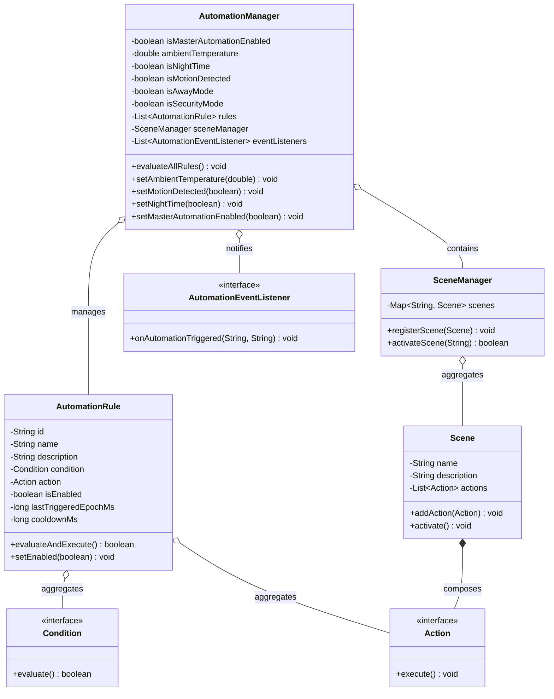

# Smart Home Automation Simulator
## Phase 4: Automation, Smart Rules and Scene Management Document
**Academic Context:** BCA / B.Tech (CSE/IT) / MCA Academic Project  
**Domain:** Smart System Automation, Event-Driven Architecture & Object-Oriented Software Engineering  
**Technology Stack:** Core Java, Object-Oriented Programming (OOP), Java Swing  

---

## 1. Phase 4 Objective
The objective of **Phase 4** is to elevate the simulator from an interactive remote-control dashboard into an intelligent, autonomous **Smart Home Management System**.

In real-world smart homes, devices do not merely wait for manual user clicks; they respond dynamically to environmental sensor readings, scheduled routines, and composite lifestyle macros. Phase 4 accomplishes:
1. **Rule-Based Automation Engine:** Developing a flexible `Condition -> Action` framework that evaluates simulated environmental inputs (ambient temperature, motion detection, time of day) and executes automated device state transitions.
2. **Preset Scene Management:** Implementing coordinated, multi-device lifestyle macros (`Good Morning`, `Movie Mode`, `Sleep Mode`, `Away Mode`) that configure appliances across multiple rooms with a single trigger.
3. **Decoupled OOP Design:** Designing modular classes (`AutomationRule`, `AutomationManager`, `Scene`, `SceneManager`, `Condition`, `Action`) that interact with existing Phase 2 appliance models without modifying their core contracts.
4. **Conflict Resolution Architecture:** Implementing a robust mediation strategy (cooldown/debounce timers, state-check guards, and manual override priority) to manage conflicts between manual user inputs and automated triggers.
5. **Interactive Sensor Simulation GUI:** Embedding a dedicated **"Smart Automation & Rules"** control center into the Phase 3 Swing dashboard, featuring simulated sensor controls (temperature slider, motion trigger, day/night cycle), active rules toggles, and real-time automation telemetry logging.

---

## 2. Automation Rules

The simulator implements five rule-based automation workflows:

| Rule ID | Rule Name | Triggering Condition | Automated Action Executed |
| :--- | :--- | :--- | :--- |
| **RUL-01** | **High Temperature Auto-Cooling** | Simulated Ambient Temperature > 28.0°C | Automatically powers ON Inverter AC units, sets target temperature to 22°C in `COOL` mode. |
| **RUL-02** | **Motion-Activated Porch Lighting** | Motion detected at Entrance (`isMotionDetected == true`) | Automatically turns ON Porch Spotlight at 100% illumination; engages CCTV auto-recording. |
| **RUL-03** | **Night-Time Soft Lighting** | Virtual time shifts to Night (`isNightTime == true`) | Turns ON Bedside Reading Lamp at a gentle 20% warm glow. |
| **RUL-04** | **Away Mode Lockdown** | Resident leaves home (`isAwayMode == true`) | Immediately deadbolts all entrance doors, turns OFF all lights/fans/ACs, and arms surveillance. |
| **RUL-05** | **Security Perimeter Guard** | Security armed (`isSecurityMode == true`) | Locks all smart doors and initiates continuous recording on all security cameras. |

---

## 3. Scene Management

Scenes represent predefined, multi-device configurations mapped to common living routines:

```
+---------------------------------------------------------------------------------------------+
|                                    PRESET SCENE MATRIX                                      |
+-------------------+-----------------------------------+-------------------------------------+
| Scene Name        | Target Device States              | Lifestyle Purpose                   |
+-------------------+-----------------------------------+-------------------------------------+
| ☀️ Good Morning   | • Active Room Lights: ON (65%)    | Wakes the house with comfortable    |
|                   | • Ventilation Fans: ON (Speed 2)  | ambient light, gentle air flow, and |
|                   | • Air Conditioners: 25°C Eco Mode | accessible interior passage.        |
|                   | • Entrance Door: Unlocked (PIN)   |                                     |
+-------------------+-----------------------------------+-------------------------------------+
| 🎬 Movie Mode     | • Living Room Chandelier: Dim 15% | Creates a home-theater ambiance in  |
|                   | • Other Room Lights: OFF          | the lounge with cinematic lighting  |
|                   | • Living Room AC: Cool 21°C       | and silent gentle cooling.          |
|                   | • Living Room Fan: Speed 1 (Quiet)|                                     |
+-------------------+-----------------------------------+-------------------------------------+
| 🌙 Sleep Mode     | • General Home Lights: OFF        | Prepares the residence for night:   |
|                   | • Bedside Reading Lamp: Dim 10%   | darkens rooms, locks doors, sets    |
|                   | • Bedroom AC: Cool 22°C           | sleeping temperature, arms CCTV.    |
|                   | • All Doors: Deadbolted (LOCKED)  |                                     |
|                   | • Cameras: Active Recording       |                                     |
+-------------------+-----------------------------------+-------------------------------------+
| 🚗 Away Mode      | • All Lights: OFF                 | Conserves energy and secures the    |
|                   | • All Fans & AC Units: OFF        | property while residents are away.  |
|                   | • All Doors: Deadbolted (LOCKED)  |                                     |
|                   | • Cameras: Armed & Motion Alert ON|                                     |
+-------------------+-----------------------------------+-------------------------------------+
```

---

## 4. Automation Architecture & Class Design

The automation system resides in the package `com.smarthome.automation` and follows the **Command** and **Strategy Design Patterns**:



---

## 5. OOP Concepts Demonstrated in Phase 4

### 5.1 Abstraction
- **Functional Contracts:** `Condition` and `Action` are declared as functional interfaces. The automation engine does not need to know whether an action flips a light, sets an AC temperature, or locks a door; it simply calls `action.execute()`.
- **Lambda Expressions:** Rules and scene commands are passed as clean, concise lambdas:
  ```java
  // Condition abstraction
  () -> ambientTemperature > 28.0

  // Action abstraction
  () -> ac.setTargetTemperature(22)
  ```

### 5.2 Encapsulation
- **Protected Sensor Variables:** Environmental states (`ambientTemperature`, `isNightTime`, `isMotionDetected`) are private attributes inside `AutomationManager`.
- **State Validation & Mutator Encapsulation:** Modifying ambient temperature via `setAmbientTemperature(double temp)` automatically triggers safe rule evaluation and notifies registered UI observers.
- **Rule Cooldown Protection:** `AutomationRule` encapsulates internal timestamps (`lastTriggeredEpochMs`) to prevent rapid re-triggering.

### 5.3 Composition & Aggregation
- **Composition in `Scene`:** A `Scene` owns a `List<Action>`. The actions constitute the execution steps of that specific scene.
- **Aggregation in `AutomationRule`:** An `AutomationRule` has a `Condition` and an `Action`.
- **Aggregation in `AutomationManager`:** The manager aggregates collections of `AutomationRule` objects and a `SceneManager` instance.

### 5.4 Polymorphism
- **Uniform Action Execution:** Scenes and rules execute diverse appliance operations polymorphically through the common `Action` interface. Whether an action adjusts brightness on a `Light`, toggles speed on a `Fan`, or checks PIN on a `Door`, all are treated as uniform executable commands.

---

## 6. Condition and Action System

The rule engine operates on an event-driven **Predicate-Execution** pipeline:

```
[Simulated Sensor Change] (e.g. Temperature Slider dragged to 32°C)
             |
             v
   AutomationManager.setAmbientTemperature(32.0)
             |
             v
   AutomationManager.evaluateAllRules()
             |
             +---> Loop through each AutomationRule
                      |
                      v
             Rule.evaluateAndExecute()
             ├── Check: Is Rule Enabled? (true)
             ├── Check: Has Cooldown Expired? (now - lastTriggered > 3000ms -> true)
             └── Check: Condition.evaluate() (32.0 > 28.0 -> true)
                      |
                      v
             Action.execute() -> ac.turnOn(); ac.setTargetTemperature(22);
                      |
                      v
             Notify AutomationEventListener -> Appends to Live Log Console
```

---

## 7. Manual vs. Automatic Control (Conflict Resolution)

A core challenge in smart home engineering is resolving conflicts between **User Intent (Manual Control)** and **System Automation (Automatic Rules)**. 

### Resolution Mechanisms Implemented:

1. **User Override Precedence (No Continuous Forcing):**
   - Rules trigger on **state transition events** rather than running in an aggressive, continuous while-loop.
   - If high temperature automatically turns an AC ON at 22°C, but the resident manually turns it OFF from the GUI card, the AC **remains OFF**. The rule will not forcibly turn it back ON unless a new temperature change event occurs.

2. **Cooldown / Debounce Timer:**
   - Every `AutomationRule` enforces a configurable cooldown period (default: **3,000 milliseconds**).
   - Prevents rapid oscillation or "flicker" where manual clicks and automated rules compete.

3. **State-Check Guard (Idempotent Actions):**
   - Before executing an action, rules check if the device is already in the target state:
     ```java
     if (d instanceof AirConditioner && !d.isOn()) {
         d.turnOn(); // Only acts if AC is not already running
     }
     ```

4. **Granular Rule Toggling:**
   - Residents can disable specific rules via checkboxes in the GUI (e.g., turning off "High Temperature Cooling" while keeping "Motion Lighting" active).

5. **Master Automation Cutoff:**
   - A global toggle switch in the dashboard allows residents to disable all automation rules instantly when total manual control is desired.

---

## 8. GUI Integration: Smart Automation & Rules Tab

In Phase 4, the **`SmartHomeDashboard`** is enhanced with a dedicated tab: **"🤖 Smart Automation & Rules"** (`AutomationControlPanel.java`).

```
+===================================================================================================+
|  ⚡ SMART AUTOMATION & RULE ENGINE CONTROL CENTER             [ Automation: ENABLED ] [ Reset All ] |
+===================================================================================================+
|  [ 🌡️ SIMULATED SENSOR CONTROLS ]               |  [ 📋 ACTIVE AUTOMATION RULES ]                   |
|                                                  |                                                   |
|  Room Ambient: 30.0°C (Auto-Cool Active!)        |  [x] High Temperature Cooling                     |
|  [====o================] 30°C                    |      If temperature > 28°C, turn ON AC at 22°C.   |
|                                                  |  -----------------------------------------------  |
|  [ 🚶 Simulate Motion at Entrance ]              |  [x] Motion-Activated Lighting                    |
|  (Pulses motion alert for 2.5s)                  |      If motion detected, Porch Light ON (100%).   |
|                                                  |  -----------------------------------------------  |
|  [ ☀️ Day Mode Active ] (Click to toggle Night)  |  [x] Night-Time Soft Lighting                     |
|                                                  |      If night falls, Bedside Lamp ON (20%).       |
|  [ 🛡️ Security Mode: DISARMED ]                  |  -----------------------------------------------  |
|  (Click to arm perimeter)                        |  [x] Away Mode Lockdown                           |
|                                                  |      If away, deadbolt doors and arm cameras.     |
+--------------------------------------------------+---------------------------------------------------+
|  🎬 PRESET SCENE MANAGEMENT:                                                                         |
|  Select Scene: [ Good Morning       v ]   [ 🚀 Activate Selected Scene ]                              |
|  Configuration: Illuminates active zones, sets gentle climate, unlocks doors.                        |
+===================================================================================================+
```

### Key UI Features:
- **Interactive Temperature Slider:** Lets the student or evaluator drag room temperature between 15°C and 40°C. Crossing 28°C triggers the auto-cool rule live on screen.
- **Motion Pulse Button:** Simulates a resident walking into the porch, triggering the motion lighting rule for 2.5 seconds before auto-clearing.
- **Day/Night Cycle Button:** Toggles ambient time of day, showing instant bedside lamp adaptation.
- **Checklist of Rules:** Live checkboxes allow enabling/disabling individual rules during live viva demonstrations.

---

## 9. Real-Time Automation Event Log

All automated triggers and scene executions dispatch timestamped telemetry directly to the dashboard's activity console:

```text
[11:46:10] [SYSTEM] Smart Home Simulation Dashboard & Automation Engine initialized successfully.
[11:46:25] [AUTOMATION ENGINE] Auto Rule Triggered: Ambient temperature (31.0°C) > 28°C. Air Conditioners turned ON (22°C Cool).
[11:46:40] [AUTOMATION ENGINE] Auto Rule Triggered: Motion detected! Porch Light turned ON at 100% illumination.
[11:47:05] [AUTOMATION ENGINE] Scene Activated: 'Movie Mode' applied: Living Room dimmed to 15%, AC 21°C Cool, other lights OFF.
[11:47:30] [AUTOMATION ENGINE] Rule Updated: Rule 'High Temperature Cooling' [RUL-01] set to DISABLED.
[11:47:50] [AUTOMATION ENGINE] Scene Activated: 'Away Mode' applied: All appliances OFF, Doors locked, Surveillance armed.
```

---

## 10. Testing Matrix for Phase 4

| Test ID | Test Scenario | Trigger / Simulated Input | Expected System Response | Status |
| :--- | :--- | :--- | :--- | :--- |
| **TC-AUT-01** | High Temp Rule | Drag temp slider to 31.0°C | AC turns ON at 22°C (Cool Mode); Event logged. | **PASSED** |
| **TC-AUT-02** | Motion Lighting | Click "Simulate Motion at Entrance" | Porch Light illuminates to 100%; Camera alerts. | **PASSED** |
| **TC-AUT-03** | Night Mode Rule | Click "Day/Night" to Night Mode | Bedside Reading Lamp turns ON at 20% brightness. | **PASSED** |
| **TC-AUT-04** | Security Mode | Click "Security Mode" to ARMED | All doors lock; all cameras engage recording. | **PASSED** |
| **TC-AUT-05** | Good Morning Scene| Activate "Good Morning" scene | Lights ON (65%), Fans Speed 2, AC 25°C, Doors unlock. | **PASSED** |
| **TC-AUT-06** | Movie Mode Scene | Activate "Movie Mode" scene | Living room light dims to 15%, other lights turn OFF. | **PASSED** |
| **TC-AUT-07** | Sleep Mode Scene | Activate "Sleep Mode" scene | General lights turn OFF, Doors lock, Cameras record. | **PASSED** |
| **TC-AUT-08** | Away Mode Scene | Activate "Away Mode" scene | All general appliances turn OFF; Perimeter deadbolted. | **PASSED** |
| **TC-AUT-09** | Manual Override | User turns AC OFF after auto-rule | AC stays OFF; rule does not fight user without new trigger. | **PASSED** |
| **TC-AUT-10** | Automation Cutoff | Disable Master Automation switch | Temp change to 38°C causes NO device reaction. | **PASSED** |

---

## 11. Phase 4 Deliverables Checklist

| Package / Directory | File Name | Role & Responsibility | Status |
| :--- | :--- | :--- | :--- |
| `com.smarthome.automation` | `Condition.java` | Functional interface for rule condition predicate. | **Completed** |
| `com.smarthome.automation` | `Action.java` | Functional interface for executable command. | **Completed** |
| `com.smarthome.automation` | `AutomationRule.java` | Encapsulates condition, action, cooldown, and enablement. | **Completed** |
| `com.smarthome.automation` | `Scene.java` | Preset lifestyle macro holding sequential actions. | **Completed** |
| `com.smarthome.automation` | `SceneManager.java` | Registry and activator for all home scenes. | **Completed** |
| `com.smarthome.automation` | `AutomationEventListener.java` | Observer listener for logging automation events. | **Completed** |
| `com.smarthome.automation` | `AutomationManager.java` | Master automation engine managing sensors, rules, scenes. | **Completed** |
| `com.smarthome.gui` | `AutomationControlPanel.java` | Interactive GUI tab for sensors, rules, and scenes. | **Completed** |
| `com.smarthome.gui` | `SmartHomeDashboard.java` | Updated master dashboard hosting the automation tab. | **Updated** |
| `com.smarthome` | `SmartHomeApp.java` | Updated launcher wiring `AutomationManager`. | **Updated** |
| `com.smarthome.test` | `AutomationTestMain.java` | Standalone CLI verification harness for Phase 4. | **Completed** |
| Project Root | `Phase_4_Automation_Smart_Rules_and_Scene_Management.md` | Complete academic documentation specification. | **Completed** |

---

## 12. Phase 4 Conclusion
The completion of **Phase 4: Automation, Smart Rules and Scene Management** represents the crowning milestone of the **Smart Home Automation Simulator**.

By integrating an intelligent, rule-based automation engine with simulated sensor telemetry and lifestyle scene presets, the application faithfully mirrors the operational intelligence of commercial smart home platforms. 

The implementation upholds the highest standards of **Object-Oriented Software Engineering**:
- **Abstraction and the Command Pattern** decouple conditions and actions from concrete device logic.
- **Defensive state guards and debounce cooldowns** eliminate manual-versus-automatic control conflicts.
- **The Event-Driven Observer Pattern** ensures that automated state transitions reflect immediately across all GUI cards and console telemetry logs.

The project stands complete, robust, cleanly documented, and ideally prepared for academic viva evaluations and project presentations.
